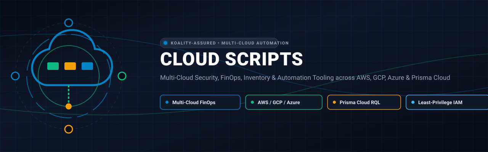
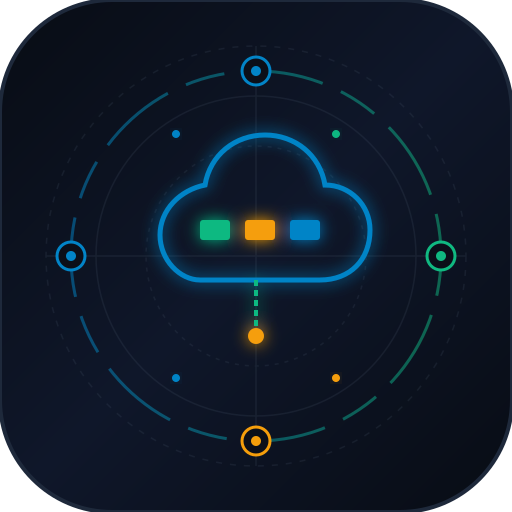

<div align="center">



# Cloud Scripts

<p align="center">
  
</p>

**Multi-Cloud Security, FinOps, Inventory & Automation Tooling across AWS, GCP, Azure & Prisma Cloud**

[](https://github.com/Koality-Assured/cloud-scripts/actions/workflows/ci.yml)
[](LICENSE)
[](pyproject.toml)
[]()
[](https://conventionalcommits.org)

</div>

---

Production-grade, generalized multi-cloud automation, inventory, cost optimization (FinOps), and security posture tooling across **Amazon Web Services (AWS)**, **Google Cloud Platform (GCP)**, **Microsoft Azure**, and **Palo Alto Networks Prisma Cloud**.

---

## Architecture & Layout
```
cloud-scripts/
├── aws/                   # Amazon Web Services suite
│   ├── cloudtrail/        # SQS queue depth, dead-letter queue, & delivery health
│   ├── cloudwatch/        # Log group ingestion cost analysis & retention policy enforcement
│   ├── cost_explorer/     # Granular spend breakdown by service, operation, and usage type
│   ├── iam/               # GitHub Actions OIDC role provisioning and least-privilege setup
│   ├── s3/                # Multi-account S3 security posture, storage metrics, & prefix scanner
│   ├── sso_config/        # Dynamic AWS CLI SSO profile generation from AWS Organizations
│   ├── vpc/               # VPC network topology & ENI connection density analysis
│   └── serverless/        # Synthetic canary healthcheck handler & S3 worker trigger pipeline
├── gcp/                   # Google Cloud Platform suite
│   ├── logging/           # Cloud Logging storage bucket retention & sink exclusion audits
│   ├── iam/               # GCP Workload Identity Federation for keyless GitHub Actions CI/CD
│   ├── storage/           # GCS Uniform Bucket-Level Access (UBLA) & public prevention audits
│   └── networking/        # GCP VPC network topology, subnets, and peering inventory
├── azure/                 # Microsoft Azure suite
│   ├── monitor/           # Log Analytics Workspace retention optimization & daily ingestion caps
│   ├── iam/               # Microsoft Entra ID (Azure AD) Federated Credentials for GitHub Actions
│   ├── storage/           # Storage Account TLS 1.2, public blob access, & HTTPS enforcement
│   └── networking/        # Azure VNet topology & connected device density analysis
├── prisma/                # Prisma Cloud enterprise suite
│   ├── client.py          # Enterprise client: token auto-refresh & exponential backoff
│   ├── rql_config_inventory.py  # RQL config search with security presets & custom queries
│   ├── rql_event_audit.py # Cloud administrative activity audit via event RQL
│   ├── cloud_account_health.py # Onboarded cloud account connection status & scan health
│   └── alert_remediation_audit.py # Security alert prioritization & top violation analysis
├── tests/                 # Automated unit tests and mock suites
└── .github/workflows/     # Continuous integration (Linting & Pytest)
```
---
## Design Principles & Security Hygiene
1. **Zero Hardcoded Secrets & No Proprietary Data**: No AWS account numbers, private tenant IDs, internal domain names, or secrets are embedded. All identifiers are dynamic and supplied via standard configuration.
2. **Keyless CI/CD First**: Full suites for provisioning **OIDC Workload Identity Federation** across AWS (IAM OIDC), GCP (Workload Identity Federation), and Azure (Entra ID Federated Credentials), eliminating long-lived credentials.
3. **Safe by Default (Dry-Run)**: Any script mutating cloud resources (retention policies, IAM roles, quotas) executes in **DRY-RUN** mode by default and requires explicit confirmation (`--apply`) to execute.
4. **Standard Credential Resolution**: Integrates with native cloud authentication:
   - **AWS**: AWS CLI profiles (`~/.aws/config`), IAM Identity Center (SSO), STS AssumeRole, IAM instance profiles.
   - **GCP**: Application Default Credentials (`gcloud auth application-default login`) or Service Account keys.
   - **Azure**: `DefaultAzureCredential` (`az login`, Managed Identity, environment credentials).
   - **Prisma Cloud**: Environment variables (`PRISMA_ACCESS_KEY`, `PRISMA_SECRET_KEY`, `PRISMA_API_URL`).
5. **Cross-Platform Resilience**: Compatible across Linux, macOS, and Windows. Outputs support `table` (console), `csv` (spreadsheets / data warehouse), and `json` (automated ingestion).
---
## Installation
Clone the repository and install dependencies in your virtual environment:
```bash
git clone https://github.com/Koality-Assured/cloud-scripts.git
cd cloud-scripts
# Core dependencies (AWS & Prisma Cloud)
pip install -e .
# Full multi-cloud installation (AWS, GCP, Azure, Prisma Cloud, and Dev tools)
pip install -e ".[all,dev]"
```
---
## Quickstart Examples
### AWS Cost & Retention Optimization
```bash
# Analyze CloudWatch log storage and calculate potential savings with 30-day retention
python aws/cloudwatch/cw_log_cost_analyzer.py --format table
# Enforce 30-day retention on flow logs across all accounts (preview first)
python aws/cloudwatch/cw_log_retention_enforcer.py --filter-pattern "flowlogs" --retention-days 30 --apply
```
### AWS FinOps Spend Breakdown
```bash
# Query monthly spend by operation for CloudWatch and S3
python aws/cost_explorer/cost_breakdown.py \
  --services "Amazon CloudWatch,Amazon Simple Storage Service" \
  --group-by OPERATION \
  --format csv \
  --output-file output/monthly_spend.csv
```
### Keyless CI/CD Federation
```bash
# AWS: Provision IAM Role for GitHub Actions runner
python aws/iam/github_oidc_role_provisioner.py \
  --role-name "github-runner" \
  --repo "my-org/my-repo" \
  --branch "main" \
  --policy-arn "arn:aws:iam::aws:policy/ReadOnlyAccess" \
  --apply
# GCP: Plan Workload Identity Federation
python gcp/iam/github_workload_identity_setup.py \
  --project-id "my-project" \
  --project-number "123456789012" \
  --service-account "deployer@my-project.iam.gserviceaccount.com" \
  --repo "my-org/my-repo"
# Azure: Plan Entra ID Federated Credentials
python azure/iam/github_federated_credential_setup.py \
  --app-name "github-actions-app" \
  --repo "my-org/my-repo" \
  --tenant-id "00000000-0000-0000-0000-000000000000" \
  --subscription-id "11111111-1111-1111-1111-111111111111"
```
### Prisma Cloud Security Posture
```bash
# Export Prisma credentials
export PRISMA_ACCESS_KEY="your-access-key"
export PRISMA_SECRET_KEY="your-secret-key"
# Scan all clouds for public storage buckets
python prisma/rql_config_inventory.py --preset aws-public-s3 --format table
# Prioritize top 10 alert violations causing team fatigue
python prisma/alert_remediation_audit.py --format table
```
---
## Testing & Quality Assurance
Run the test suite and code linter:
```bash
# Run unit tests
pytest -v tests/
# Run code linter
ruff check .
```
---
## License
This project is licensed under the MIT License - see the [LICENSE](LICENSE) file for details.
